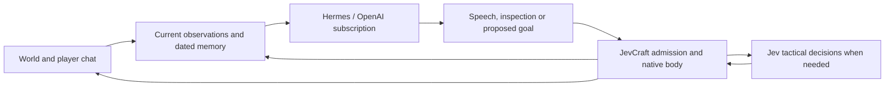

# Standalone Tolik: implementation and live result

The standalone runtime is published on [rkhazh/jevcraft, tolik-hermes](https://github.com/rkhazh/jevcraft/tree/tolik-hermes).
Installation, subscription authentication and launch commands are in
[tolik/README.md](../tolik/README.md).

## What was rebuilt

Hermes handles understanding, planning and Russian speech through its actual
OpenAI Codex subscription provider. JevCraft retains native gameplay execution,
Jev tactical choices, survival, fresh goal admission and observed completion.
The old NetTyan consultation scheduler is not imported.

The existing Tolik profile, 166 dated memory records, native body state and
standing permissions were migrated into the ignored local runtime directory.
Chat, validated bot-eye images and optional Persona Lab voice transport are
available. Credentials and client assets are not published. Streaming collectors
and Live2D remain separate Persona Lab services.

The reference [hermes-and-jev-play-minecraft](https://github.com/teknium1/hermes-and-jev-play-minecraft/tree/440bec09ee76523a706510601efcbda57df030ad)
uses milestone planning and tactical selection in a small independent Mineflayer
demo. This implementation applies that separation to the existing JevCraft body;
it does not copy the demo objectives or claim its benchmarks. Actual
[Hermes source](https://github.com/NousResearch/hermes-agent/tree/6b21d0564de0492e2ebd0d8f63fca86c03b5c892)
is pinned and installed separately.

New messages invalidate an outdated plan. Uncertain goal submission is not
blindly retried. Speech can still be delivered when a physical proposal is
invalid. Native receipts distinguish admission from verified physical success.
Owned subprocesses stop on timeout, disconnect, request or budget exhaustion.

## Verification

- Existing JevCraft suite: **494 passed**.
- Standalone scheduler, memory, launcher, voice and vision suite: **44 passed**.
- Source Persona Lab baseline: **481 passed**, without modifying NetTyan.
- Python compilation, installer shell syntax and Git whitespace checks passed.
- Independent code review defects received regression tests and fixes.

The first live attempt connected but its three planner launches failed before
inference: resolving the Python interpreter symlink bypassed the Hermes virtual
environment. It was stopped after 25.7 seconds with no provider calls. A real
temporary-venv package-import regression reproduced the failure and passes with
the corrected launcher. The successful gameplay revision was `eb7a331`.

## Actual demonstration

Run `20261106T214147.626737Z`, 7 November 2026, 00:41:47–00:46:15 Moscow.
The five-minute allocation ended after **267.9 seconds**, at its **24 Hermes
turn** cap. The owned game body exited successfully; no controller remains running.

| Observation | Result |
| --- | --- |
| Incoming player messages | 10 recorded |
| Delivered speech | 13 native `sent` receipts |
| Verified goals | 1 approach to player, 1 remembered-place visit, 6 local moves |
| Stale plans withheld | 3 after new input |
| Visual input | 23 image-bearing calls, 11 distinct images |
| Sampled movement | At least 71.73 blocks across 126 observations |
| Final state | Health 20, food 20, no active persona goal |
| Planner errors in successful run | 0 |

Tolik said “Здарова, Скиппер! Как жизнь?”, then responded to the actual approach
request and reached within three blocks of the player in 8.86 seconds. He later
selected the remembered village reference and reached it. That receipt verifies
arrival at the reference, not current village ownership or access.

For the requested block removal, Hermes inspected the exact cell and identified
grass. It submitted **no digging goal** because that cell was outside the copied
house-project edit scope. This was a local configuration restriction, not an
observed Minecraft server denial. In-game consent does not rewrite that scope.

One reply incorrectly blamed server protection; the following reply corrected
that claim. After the run, the prompt was clarified to distinguish local scope
from observed server rejection. One text-only replay of the recorded input
through real Hermes then explained the local restriction without claiming a
server refusal. This replay made no game connection or physical action and is
not an additional live gameplay qualification.

Late in the run, the native body recorded a hit and a transient health value of
19, recovering to 20. Survival placed two dirt blocks under its existing temporary
placement permission and raised Tolik to Y68. Both placements have server-update
receipts; dirt changed 45→43. No digging or construction improvement was verified.
The subsequent apology does not prove that a conversational request suppresses
native defensive behavior. The final jump request arrived during turn 24,
invalidated that plan, and remained unanswered at the cap.

## Usage and remaining limits

The successful run reported 580,192 input tokens and 1,261 output tokens through
the subscription provider, with zero reported cache-read tokens. These are
provider-returned counts, not a dollar invoice. There was no paid OpenAI API fallback.
Jev made three HTTP attempts: two successful responses reported a combined
**$0.000664692**; one aborted attempt has unknown charge status. The subscription
smoke and later wording replay are separate from these gameplay totals.

This demonstrates working conversation, grounded inspection, navigation and
survival through the new architecture. It does not establish general autonomous
building, unrestricted edits, reliable social control of defensive behavior, or
community voice. Voice remains disabled by default; previous AgiCraft UDP
authentication was unresolved. Local voice tests do not establish remote audio.

Exact inputs, outputs, observations, images and usage receipts remain local under
`.tolik/runs/20261106T214147.626737Z/`. The final simplified bot-eye image is
`vision/capture-759a806fc3bc4095a1ee57a9cf245606.png`; it is not a vanilla-client
screenshot. Source and sanitized findings are public; private chat history and
authentication files are not.
